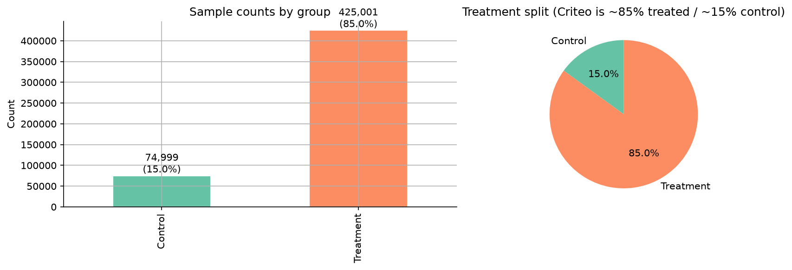
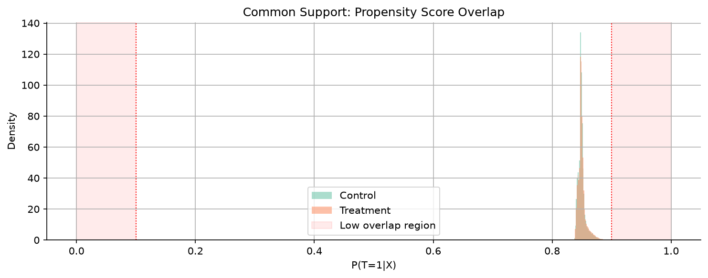
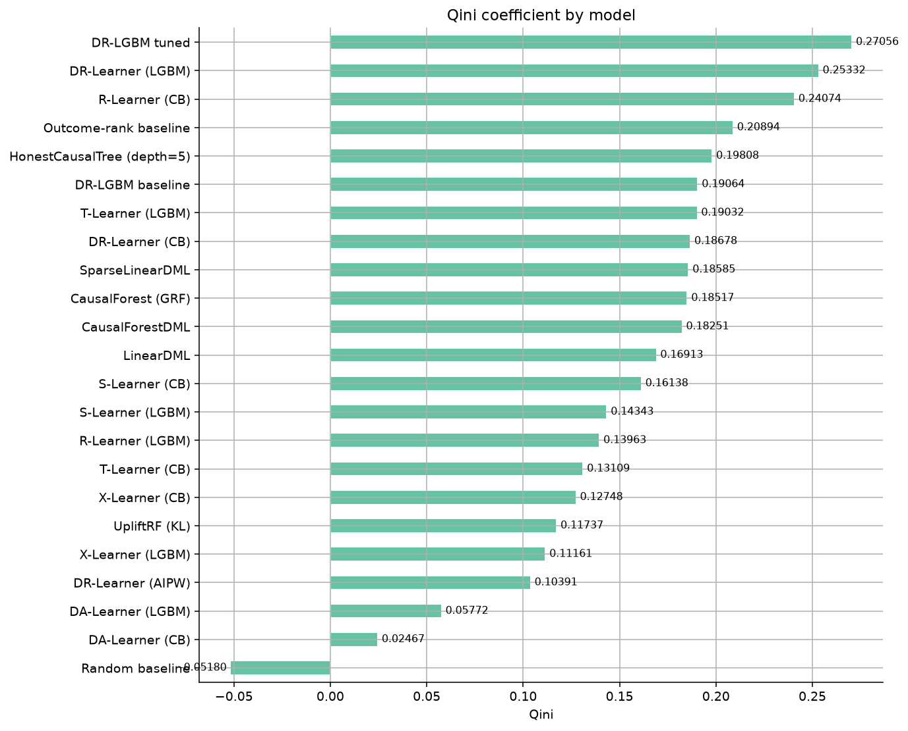
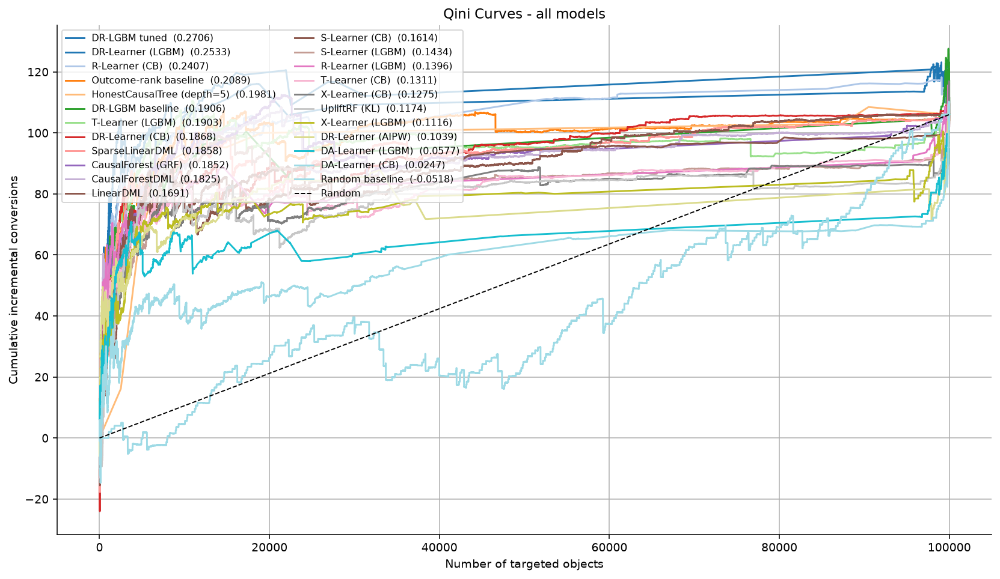
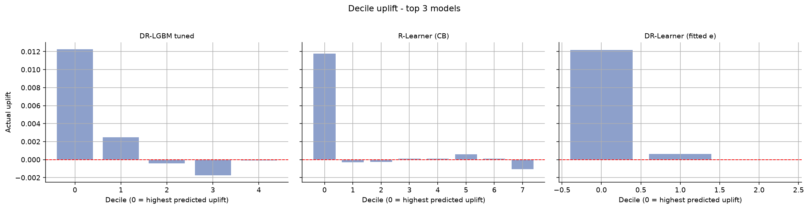
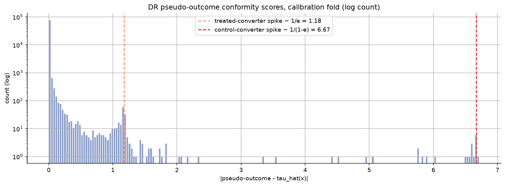
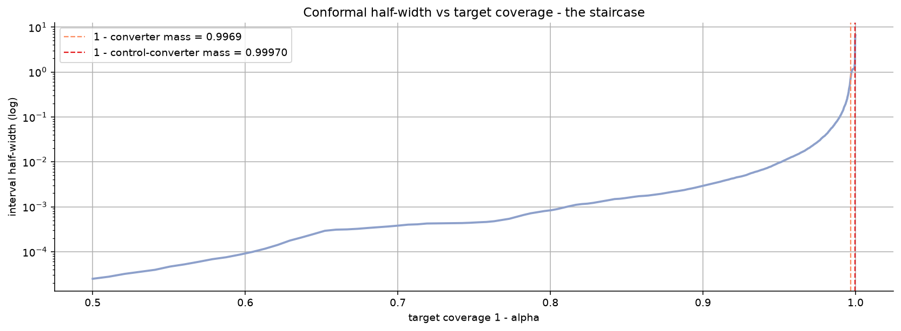

# Criteo Uplift Modeling - Benchmarks

A reproducible benchmark of uplift-modeling approaches on the [Criteo Uplift Prediction Dataset](https://ailab.criteo.com/criteo-uplift-prediction-dataset/) (~13.98M rows, 12 anonymized features `f0..f11`, randomized treatment offer, binary conversion outcome).

> **Status: executed end-to-end** on a 500K-row sample (20% hold-out, seed 42). The numbers below are this repo's actual results, not literature values. They will shift with sample size and seed - treat the ranking as illustrative, and read notebook 06's bootstrap tiers rather than the raw point ordering. See [Caveats](#caveats).

Covered approach families:

- **Meta-learners** (causalml) - S, T, X, R, DR - with LightGBM and CatBoost base learners
- **Domain-adaptation learner** (econml `DomainAdaptationLearner`) - the "DA" row
- **Tree-based causal methods** - Uplift Random Forest / KL (causalml), Causal Forest / GRF (econml), Honest Causal Tree (econml)
- **Double Machine Learning** (econml) - LinearDML, SparseLinearDML, CausalForestDML
- **Advanced** - DragonNet (causalml, needs TensorFlow), DR-AIPW ATE with influence-function CI (causalml), DMLIV for LATE (econml)
- **Hyperparameter optimization** - Optuna TPE on DR-loss pseudo-outcomes
- **Conformal prediction** - split conformal on DR pseudo-outcomes (conformal meta-learners) for finite-sample individual-treatment-effect intervals

## Project layout

```
00_eda.ipynb              - loading, EDA, propensity/overlap check, SHAP HTE drivers
01_meta_learners.ipynb    - S / T / X / R / DR × {LightGBM, CatBoost} + DA (econml) + outcome-rank baseline
02_tree_methods.ipynb     - Uplift RF (causalml), Causal Forest (GRF), Honest Causal Tree
03_dml.ipynb              - LinearDML, SparseLinearDML, CausalForestDML
04_advanced.ipynb         - DragonNet, DR-AIPW ATE CI, DMLIV (LATE)
05_hpo.ipynb              - Optuna + DR-loss; baseline vs tuned
06_benchmark.ipynb        - leaderboard, bootstrap Qini CIs + tiers, ERUPT policy value, Qini curves
07_conformal.ipynb        - conformal prediction intervals for individual treatment effects (standalone)

METRICS.md  - AUUC, Qini, Uplift@k, DR-loss / R-loss, ERUPT, CIs
RESEARCH.md - dataset facts, literature, best practices, pitfalls
```

## Quick start (uv)

This project uses [uv](https://docs.astral.sh/uv/) for dependency management.

```bash
uv sync                       # create .venv and install from pyproject.toml + uv.lock
uv run jupyter lab            # launch Jupyter in the project environment

# DragonNet (notebook 04) additionally needs TensorFlow. Its pins conflict with
# the locked stack on Python 3.12, so install it separately if you want it:
uv pip install "tensorflow>=2.16"
```

Run the notebooks in order. Each of `01`-`05` writes its results to `artifacts/*.pkl`; `06_benchmark.ipynb` loads all artifacts and builds the final leaderboard. `07_conformal.ipynb` is standalone (it loads the dataset directly and needs no artifacts). `artifacts/`, generated PNGs, and `leaderboard.csv` are git-ignored (reproducible outputs).

## Data

Criteo disabled the S3 bucket that `sklift.datasets.fetch_criteo` downloads from (it now returns HTTP 403), so the stock loader no longer works. The notebooks instead import `fetch_criteo` from the local [`criteo_data.py`](criteo_data.py), which pulls the same file from the official [Hugging Face mirror](https://huggingface.co/datasets/criteo/criteo-uplift) (byte-identical, same MD5) and returns the same object. The ~297 MB file is cached under `~/scikit-uplift-data/` and downloads once on first run. No manual step is needed.

## Conventions

- All code, comments, and prose in English.
- `SEED = 42`, `SAMPLE_SIZE = 500_000` for prototyping; set `SAMPLE_SIZE = None` for the full ~14M-row run (recommended for the final leaderboard - see caveats).
- Splits are stratified on `(treatment × conversion)`; the (control, converted) cell is the scarcest (~0.03% of rows).
- A fixed stratified-random 20% hold-out (seed=42) is never used during HPO.
- HPO objective: DR-loss (doubly-robust pseudo-outcome MSE) - see [METRICS.md §2.2](METRICS.md).
- Final model selection: Qini AUC on the hold-out, read via bootstrap CIs / tiers (notebook 06), not a raw point-estimate ordering.

## Dataset

```python
from criteo_data import fetch_criteo   # local drop-in; sklift's S3 URL is dead (403)
ds = fetch_criteo(target_col='conversion')
# 13.98M rows | 12 features f0..f11 | treatment (offer) / conversion
# `.data` holds features only; `exposure` is reached via treatment_col='exposure' or 'all'
```

- `treatment` - ad offered (randomized; valid instrument Z). Skewed **~85% treated / 15% control** (treatment ratio ≈ 0.85) - an unequal-allocation RCT, not 50/50.
- `exposure` - ad actually viewed (endogenous treatment T); load with `treatment_col='all'`.
- `conversion` - binary outcome Y. Recomputed on the full v2.1 file: overall CR 0.2917%, control 0.1938%, treated 0.3089%.
- ATE = +0.1152 pp on the full data (SE 0.0000344, z = 33.5; relative lift +59.5%). The 500K sample used here gives +0.1252 pp, which is 0.5 SE away - the sample is representative, not a fluke.

> Earlier versions of this README quoted control CR 0.22% and ATE +0.08 pp with a +35-40% lift. Those are v1-dataset figures and are wrong for the v2.1 file this repo ships against; they have been replaced with values recomputed from the cached file.
- The pair (`treatment`, `exposure`) supports an IV / LATE analysis under one-sided non-compliance (notebook 04).



*Unequal-allocation RCT: ~85% treated, ~15% control (500K sample). Control is the scarce arm and dominates the evaluation variance.*



*Common support, as audited in notebook 00 with a cross-validated logistic regression: propensity sits in a tight band around P(T=1|X) ~ 0.85 (min 0.82, max 0.93, sd 0.007), matching the 85% treatment ratio. About 0.08% of scores edge past 0.9.*

Caveat on this figure: it describes a logistic-regression propensity, which is not the model the DR pipelines fit. A cross-fitted `LGBMClassifier` on the same data spans [0.497, 0.99] with sd 0.016 and does reach the upper clip bound, because a 300-tree booster fits noise on a treatment that is constant-probability by design. Overlap genuinely holds here; the point is that an audit run with a constrained learner cannot certify a pipeline that uses a flexible one. Notebooks 04 and 05 now pass the known constant instead, and both show side by side what the fitted version costs.

## Which library provides what

| Package | Role in this project |
|---------|----------------------|
| **scikit-uplift** | metrics (`qini_auc_score`, `uplift_auc_score`, `uplift_at_k`, `qini_curve`) and uplift plots (dataset now loaded via `criteo_data.py`) |
| **causalml** | meta-learners (S/T/X/R/DR), Uplift Random Forest (`inference.tree`), DragonNet |
| **econml** | DML (Linear/SparseLinear/CausalForestDML), Causal Forest (`grf`), DMLIV, `DomainAdaptationLearner` (DA) |
| **lightgbm / catboost** | base learners |
| **optuna** | HPO (notebook 05) |
| **shap** | HTE feature importance (notebook 00) |

## Key takeaways (this repo's executed results, 500K sample)

The main finding is that the leaderboard is mostly noise at this sample size. The 20% hold-out has only ~300 conversions, so Qini estimates are wide and most models are statistically tied.

| Model (top of leaderboard) | Qini | 95% bootstrap CI |
|---|---|---|
| DR-LGBM tuned (nb 05) | 0.271 | [0.145, 0.408] |
| R-Learner (CatBoost) (nb 01) | 0.241 | [0.120, 0.376] |
| DR-Learner, fitted e (nb 04) | 0.238 | [0.093, 0.383] |
| Outcome-rank baseline | 0.209 | [0.176, 0.247] |

- The ranking is not significant: the leader beats the runner-up in only 68% of 2,000 bootstrap resamples, and 16 of 23 rows fall inside its "top tier" (not beaten in ≥97.5% of resamples). Two of them sit within Monte-Carlo error of that boundary. Read tiers, not the point ordering.
- The outcome-rank baseline (Qini 0.209) beats most real uplift models. Plain "target by predicted P(Y=1|X)" is hard to beat on this dataset.
- The textbook ranking DR > R > X > T > S does not hold: the base learner matters more than the recipe. R-Learner is 2nd with CatBoost (0.241) but near the bottom with LightGBM (0.140), and both X-Learners sit at the bottom.
- **Do not fit a propensity you already know.** Treatment is Bernoulli(0.85) by design, but a 300-tree LightGBM asked to predict it produces ê spanning [0.497, 0.99]. In notebook 04 that inflates the AIPW standard error 59% above a plain difference in means and pushes the ATE confidence interval across zero; with the known constant, AIPW is *more* efficient than the difference in means (SE ratio 0.96) and the CI is [+0.00065, +0.00143]. In notebook 05 the same mistake supplied 63% of the DR pseudo-outcome's variance and biased its mean.
- **DR-loss HPO finds no signal here.** Against a constant-mean model on the same folds, the best of 50 configs gains +2.5e-5 (z = 0.9, and optimistic) with the known propensity and -4.4e-5 with a fitted one; the untuned baseline is significantly worse than the constant in both. Both searches pick the most shrunk config, and their tuned-vs-baseline Qini goes opposite ways (0.271 vs 0.191; 0.105 vs 0.159). The top leaderboard row comes out of that search.
- **Ranking well is not estimating well.** The leaderboard now prints `tau_min`/`tau_max`. 17 of the 21 CATE models predict individual effects more than 100x the ~0.00125 ATE - `R-Learner (CB)` reaches -1.62. Those models rank acceptably and are useless for sizing a campaign. The forests are the well-behaved exception (`CausalForestDML` spans [-0.007, +0.050]).
- **AUUC adds nothing next to Qini here.** Under sklift's normalization with randomized assignment the two are nearly proportional (ratio 0.0330-0.0338 across all rows) and rank identically on this run.
- Policy value (ERUPT) is within noise: the best top-20% policy value (0.00348) sits above treat-all (0.00325) and treat-none (0.00200), but the gap to treat-all is smaller than the estimator's standard error at ~300 conversions. This run does not establish that targeting beats blanket treatment.
- Uplift@10%/@20% now carry bootstrap CIs, because they rest on very little: `strategy='by_group'` puts 1,500 control rows in the top decile, holding 3-26 conversions depending on the model. The leader captures 201 treated conversions there against the outcome-rank baseline's 241, and still scores higher, purely because 16 rather than 24 control converters landed in its slice.
- HTE drivers depend on the lens: `f8` tops mean |SHAP| on the treated-arm outcome model, while the standardized SparseLinearDML coefficients put `f11` first. A linear final stage only sees linear heterogeneity, so this is a difference in what each method can detect.

Leaderboard, all Qini curves, and decile uplift for the top 3 models (hold-out, 500K sample):







The curves make the "mostly noise" point visible: the top ~16 models form one overlapping band, well above the random diagonal but not cleanly separable from each other; only the two DA-Learners, the X-Learners, `UpliftRF (KL)` and `DR-Learner (CB)` trail clearly. In the decile plots the leaders put the real uplift in the top decile and sit flat-to-negative elsewhere - the ranking signal is thin and lives at the very top.

### Uncertainty of individual effects (notebook 07)

Point predictions are only half the story. `07_conformal.ipynb` builds finite-sample, distribution-free prediction intervals for the individual treatment effect via split conformal on doubly-robust pseudo-outcomes (conformal meta-learners; no weighting is needed under the randomized 85/15 design). The honest finding on a rare binary conversion: the marginal coverage guarantee holds but is nearly vacuous. Because `P(ITE = 0) >= 1 - p1 - p0 ~ 99.5%`, the trivial interval `{0}` is already "valid" at any conventional level, and a semi-synthetic check with known ground-truth strata shows marginal ITE coverage sitting on nominal (0.91 at the 90% level) while coverage on the affected units - the persuadables and sleeping dogs - is exactly zero.





The pseudo-outcome scores form four spikes (top): 99.7% are tiny, and the rare converters sit at `~1/e` and `~1/(1-e)`. Interval width then follows a staircase (bottom): it stays under 0.01 up to ~95% coverage, widens to 0.1-0.3 at 99-99.5%, then steps to ~1.2 and ~6.7 as it absorbs the treated and control converters - step heights set by the `1/e` and `1/(1-e)` factors of the 85/15 design, not by the model. The verifiable guarantee (pseudo-outcome coverage) tracks nominal throughout; for individual-level uncertainty on rare binary outcomes, group-level statements (bootstrap tiers, quantile-group ATEs) are what remain informative.

## What may be skipped at runtime

- DragonNet (04) needs TensorFlow (`uv pip install "tensorflow>=2.16"`); the notebook skips it otherwise and continues.
- DMLIV (04) needs the `exposure` column; the notebook loads it via `fetch_criteo(..., treatment_col='all')`.

## Caveats

- Results were produced at `SAMPLE_SIZE = 500_000`. The 20% hold-out then has 306 conversions, only 30 of them in the control arm, so Qini differences are noisy - notebook 06 quantifies this with a 2,000-resample stratified paired bootstrap, and the takeaway is that most models are statistically tied. For a publishable ranking, run on the full dataset (≥1M-row hold-out) and across several split seeds.
- The bootstrap CIs are conditional: resampling within (treatment × outcome) cells fixes the conversion counts, so they understate total uncertainty. The leader is also selected on the same hold-out used to build its interval, which biases the tier narrow. Both effects push toward the "everything is tied" conclusion, so it survives them.
- `Time(s)` is wall-clock per model. Notebooks 01-06 were re-executed in one session on one machine, so the column is roughly comparable, but it is not a controlled benchmark (single run, no control over background load). Read it as an order-of-magnitude hint only.
- DragonNet did not run in this pass (TensorFlow not installed); every other model did.
